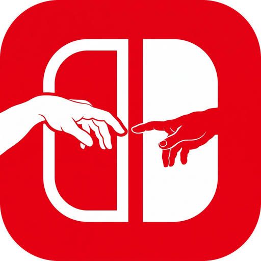

  

<h1 align="center">Touchable</h1>

<i>为你自己的 Switch 游戏带来 iOS 原生体验</i>

  
  
  
  

<a href="README.md">English</a> | <b>简体中文</b>

Touchable 为移植游戏带来 **iOS 原生体验**，优化触摸操作、虚拟按键、画面和性能。**请使用你自己的 Switch 游戏文件**，在 Apple Silicon Mac 上构建 iPhone 和 iPad 原生游戏。

## 通用改进

所有已适配游戏都包含以下改进：

- 🫧 **液态玻璃按键**：屏幕按键使用 iOS 液态玻璃样式。
- 📳 **HD 震动**：通过 Taptic Engine 或已连接的手柄提供精细震动。
- 🎮 **游戏手柄**：支持实体手柄游玩。
- 📱 **iPhone 和 iPad**：同一个应用在两种设备上全屏运行。
- 🚀 **游戏模式**：使用 iOS 和 iPadOS 原生游戏模式，优先保障游戏性能。
- 🌐 **语言设置**：在 iOS 设置中为每个应用单独选择游戏语言。

## 专属改进

点击游戏查看它的专属改进。

<table>
  <tr>
    <td align="center" width="50%">
       
      <a href="docs/games/rhythm-heaven-groove.zh-CN.md"><b>节奏天国 奇迹之星</b></a>
    </td>
    <td align="center" width="50%">
       
      <a href="docs/games/silksong.zh-CN.md"><b>空洞骑士 丝之歌</b></a>
    </td>
  </tr>
</table>

## 开始使用

1. 安装完整的 Xcode，并在 Xcode 中登录你的 Apple 账户。
2. 将你的 `prod.keys` 放入 `MyGameFiles/keys/`。
3. 将 NSP 放入对应的游戏目录。
4. 双击 `Touchable.command`。
5. 选择游戏。
6. 选择 “Build and install”（构建并安装）或 “Build IPA only”（仅构建 IPA）。

首次运行需要网络连接。启动器会准备本机工具。

## 文件入口

| 位置 | 用途 |
| --- | --- |
| [MyGameFiles](MyGameFiles/README.md) | 放入自己的 NSP 和密钥 |
| [IPA](IPA/README.md) | 查找构建完成的安装包 |
| [docs](docs/README.md) | 阅读使用说明（英文） |
| [internal](internal/README.md) | 查看代码和开发工具 |

详细要求见 [支持游戏](docs/supported-games.md)。
安装步骤见 [签名和安装](docs/signing-and-install.md)。
遇到错误时，先看 [常见问题](docs/troubleshooting.md)。
开发前请阅读 [AGENTS.md](AGENTS.md)。
详细文档和启动器界面使用英文。
本项目基于 [d2r-mobile](https://github.com/jhaizhou-ops/d2r-mobile)。

## 社区

加入 [Discord 服务器](https://discord.gg/AKhWUYNKg7)，提问、反馈问题或分享建议。

## 致谢与引用

如果你在自己的项目中使用或改编 Touchable 的触控操作设计，请注明作者 **mzhao** 并附上[本仓库链接](https://github.com/MZhao-ouo/Touchable)。
该设计包括液态玻璃虚拟手柄、按关卡适配的触摸区域、在按键之间滑动，以及可直接触摸的菜单。
引用本项目时，可使用 GitHub 上的 **Cite this repository**，或参阅 [CITATION.cff](CITATION.cff)。

## 许可和声明

代码使用 [MIT 许可证](LICENSE)。

本项目与任天堂、Team Cherry 或其他游戏发行商无关，也未获得其认可。
本项目不包含游戏文件、密钥或固件。请使用你自己拥有的游戏文件。
游戏名称、标志和美术素材归其各自所有者。仓库中的应用图标和丝之歌标志仅用于标识游戏。
