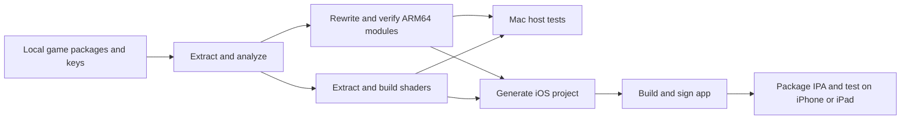

# Project summary

Snapshot date: 2026-10-18. Game coverage below comes from existing game records. See [the reorganization record](reorganization.md) for the new build and launcher checks.

## Purpose and execution model

Touchable adapts user-provided Switch games for iPhone and iPad. A Mac host supports development and diagnosis. Each game needs its own adapter and verified module profile.

The project was renamed from Nitenphone. The launcher is `Touchable.command`. On 2026-10-20 the workspace, local state, Bundle IDs, and code identifiers also changed to Touchable. The installed apps keep the previous Bundle IDs until the next install. See [the rename record](project-rename.md).

The host loads rewritten ARM64 NSO modules. The runtime supplies Switch services, memory, threads, files, input, audio, and graphics interfaces. The graphics layer translates NVN operations to Metal. Shader tools produce Metal libraries before the app build.

The upstream host supplies the loader. The Switch `rtld` module is checked as input, but it is not executed. The signal bridge handles registered indirect branches and stack operations. CPU checks do not establish full game compatibility.

## Game configuration

| Item | Silksong | Rhythm Heaven Groove |
| --- | --- | --- |
| Game ID | `silksong` | `rhythm-heaven` |
| Title ID | `010013c00e930000` | `0100d9f01d474000` |
| Product name | `Silksong` | `RhythmHeaven` |
| Manifest status | `adapted` | `in-progress` |
| App build | 13 | 28 |
| Game package version | v655360, display version 1.0.30000 | v0 |
| Engine or SDK | Unity 6000.0.50f1, IL2CPP | Native Switch SDK 21.4.5 |
| Executed modules | `main`, `subsdk0`, `sdk` | `main`, `sdk` |
| Active content | `.touchable/work/silksong/v655360/` | `.touchable/work/rhythm-heaven/base/` |
| Active rewritten modules | `.touchable/work/silksong/patched-v655360-fullview/` | `.touchable/work/rhythm-heaven/patched/` |
| Shader extraction / build adapters | `unity-switch` / `unity-nvn` | `nn-gfx-bnsh` / `nvn` |
| Bundle ID | `com.mmmz.TouchableSilksong` | `com.mmmz.TouchableRhythmHeaven` |
| Phone save path | `Documents/Saves/Silksong` | `Documents/Saves/RhythmHeaven` |
| Default Mac save path | `.touchable/saves/silksong/silksong/` | `.touchable/saves/rhythm-heaven/rhythm-heaven/` |

Read the current manifests before each task. This table is a snapshot. `game.json` controls build status and paths. A profile records module identity and runtime options.

### Hayarigami record

Hayarigami was added on 2026-10-21 from the user's base package, Title ID `010095b01af94000`.
The new adapter is `in-progress`. Its Bundle ID is `com.guiyu.TouchableHayarigami`.
It uses the shared Touchable runtime and iOS app. It does not use the previous independent Hayarigami framework.
The profile pins `main`, `subsdk0` and `sdk`. The runtime does not execute `rtld`.
All 12 NSO segment hashes and new CPU rewrite checks passed.
The shader extractor reports 127 supported vertex/fragment records and one unsupported geometry record.
New Mac/iOS Metal libraries and the iOS 26 app were built. Build 1 passed strict/deep signature verification.
A real Mac launch stopped in dyld because this machine runs macOS 15.7.5 and the backend requires macOS 26 Metal 4.
No Mac guest execution or host gameplay result is claimed.
The independent iPhone app installed and reached `nnMain`. Build 2 stopped in SDK `AddDelay`.
Shared six-channel reverb and delay changes have synthetic coverage. Gameplay checks are pending.
See [the game record](../../internal/games/hayarigami/README.md) for current evidence and limits.

### Silksong record

On 2026-10-20 a camera zoom was added for the touch layout and then removed at the user's request; only Silksong build 27 had it, and build 28 does not. The zoom source is kept as a patch in its record. The removed change zoomed the Silksong camera out for the touch layout: the distance from the D-pad center to the face-button center shows the horizontal range of the 16:9 picture (iPhone zoom 1.23, iPad 1.48). The shared `ss_display.c` gets `ss_display_set_control_span()`, `App.m` passes the span, and `runtime/ss_display.c` hooks the camera field of view and the scene bounds. Mac host tests at the iPhone and iPad aspects passed. No build was made. Evidence: `.touchable/work/silksong/reports/camera-zoom-20261020/`. On 2026-10-20 a source change in `ss_touch_ui.c` makes the save select need two taps (the first tap only selects) and lets a vertical drag scroll the inventory pane lists (equipment, tools, quests, journal) through the game's `ScrollView`. Mac host tests at 16:9 and at the iPhone and iPad aspects passed. No build was made. Evidence is local in `.touchable/work/silksong/reports/touch-confirm-scroll-20261020/`. On 2026-10-20 a source change in `TouchLayout.h` moves −, +, and the pad toggle of the Switch layout to the side edges: − and + at the safe-area edges, the pad toggle below + (next to + on a phone 375 points high). In a small iPad window, − and + stay below the window controls. The layout test (11 sizes) and an iOS Simulator harness passed. Rhythm Heaven is unchanged. No build was made. Evidence: `.touchable/work/silksong/reports/edge-menu-buttons-20261020/`. On 2026-10-20 a source change hides the touch controls on loading screens in both games. The shared pointer frame gets the mode `SS_POINTER_WAIT` and the decision `ss_pointer_controls()`. Silksong publishes `WAIT` from its GameManager and menu states. Rhythm Heaven publishes it when a screen archive opens. Mac host tests at the iPhone and iPad aspects and an iOS Simulator harness passed. Silksong build 22 and Rhythm Heaven build 35 carry the change. Both are installed on the iPhone and the iPad mini; saves were backed up and not restored. In user play on the iPhone, the logs show the controls hidden during Silksong boot, save loads, four room transitions, and quit to title, and during Rhythm Heaven boot and five screen changes. The iPad mini was not tested. Evidence: `.touchable/work/silksong/reports/loading-controls-20261020/` and `.touchable/work/rhythm-heaven/reports/loading-controls-20261020/`. Build 20 aligns the press response of the glass buttons with Apple's glass buttons: the buttons show only the system press response. After user feedback, build 21 returns the D-pad to its earlier drawn highlight at lower brightness. A simulator UI test with real touches compared them with Apple reference buttons. Build 19 was installed on the iPhone. The iPad install failed because the connection dropped, so the iPad still needs build 19. Build 19 runs Silksong at 120 Hz on a ProMotion screen. The profile sets `SS_DISPLAY_HZ=120`. The display event and the present period follow that rate. The app starts at 60 Hz and switches to 120 Hz when its display link reports 120 Hz. It returns to 60 Hz when the screen does. A Mac host test showed the same game progress at 60 Hz and 120 Hz, so Silksong game time follows real time. In about 2.7 minutes of user play on the iPhone, frame time p50 was 8.33 ms, GPU time p50 was 6.2 to 6.8 ms, and steady play dropped no presents. The shared iOS shell now declares Game Mode (`LSSupportsGameMode`) and the games category. Rhythm Heaven gets these keys with its next build and stays at 60 Hz. A shared render pass change keeps pending clears when the same targets are set again. At the iPhone size it cuts Silksong from 16 to 14 passes per frame and attachment loads from 67 MB to 61 MB. Build 18 was installed on the iPad mini and on the iPhone. Build 18 makes the D-pad as wide as the face-button diamond: 168 points on a phone and 202 points on an iPad. The D-pad center keeps its build 17 height, and the shoulder row rises to keep the touch areas apart. The user confirmed build 17 on the iPhone. Build 17 changes the touch controls. An 8-direction D-pad replaces the left stick and sends only the Switch D-pad buttons. − and + take the upper corners. On an iPad they sit below the iPadOS window controls. The tablet controls sit 24 points nearer the side edges. The controls use clear Liquid Glass in one glass container, with a dimming layer below them. A new key on a real controller hides the touch controls. A new screen touch or the disconnect of the last controller shows them again. Only the Switch layout uses these changes, so Rhythm Heaven keeps its controls. A Mac unit test, Mac host tests, and iOS simulator tests passed. No touch input was sent on a device, and no real controller was tested. Build 16 makes the pane icons above the inventory touchable. A tap on an icon goes directly to that pane. The adapter sends the game's own L or R pane event and sets the pane step to the index difference, so the game's state machine does the move. Mac host tests at 16:9 and at the iPhone and iPad aspect ratios passed. Build 14 adds touch to the menus and to the inventory (the − interface). A tap selects and confirms a menu item. A tap selects an inventory item, and a second tap on the selected item sends A. When the screen takes touches, the app hides the virtual pad and shows a back button (B) and a pad toggle. The adapter is in `internal/games/silksong/runtime/ss_touch_ui.c` and installs only for main module `fc9ea4cc`. Build 15 changes the slider rows: a tap on a row name only selects the row and does not change the value. Mac host tests on a save copy passed for the title, save select, pause, options, audio sliders, quit prompt, inventory panes, the tool sub-menu, and the map. The host tests ran at 16:9 and at the iPhone (2.17:1) and iPad (3:2) aspect ratios. No touch input was sent on a device. Shops, yes/no boxes, fast travel, and quest boards do not take touches yet. Builds 12 and 13 give the touch controls separate phone and tablet layouts. The layout is in `internal/platform/ios/TouchLayout.h`. The shoulder buttons now sit above the stick and the face buttons, clear of the game HUD. The tablet layout is 1.2 times larger and sits higher than the phone layout. Build 13 lowers it by 80 points after user feedback. The user approved the build 13 iPad layout. A Mac unit test checks nine screen sizes. Touch feel is not yet confirmed on the iPhone. Build 11 was installed on an iPad mini (iPad16,2, iPadOS 27.0.1) and on an iPhone 16 Pro Max. The profile sets `SS_RENDER_HEIGHT=1080` for every device. The shared display code keeps the output width at 1920 or less, because the game window textures are 1920×1080. The iPad output is 1644×1080, and the iPhone output is 1916×882. Two registered module cuts remove the game's 1.6 lower aspect limit. Build 10 letterboxed the 3:2 iPad screen and showed undrawn green and pink edges and a double image. Build 11 fills both screens. On both devices, each measured 300-frame group has a p50 of 16.67 ms and zero dropped frames. The GPU time is about 1.7 times the build 10 value. The memory footprint is about 2.3 GB, about 1.0 GB below the system limit. The checks sent no touch input. The profile expires on 2026-10-25. Build 9 passed a fresh rebuild, installation, and bounded iPhone startup. All 21 checked save-related files matched the pre-install backup. The earlier records report working phone menus, gameplay, touch controls, external controllers, saves, save-and-quit, reload, adaptive aspect ratio, and Core Haptics. Build 8 improves frame timing and reduces render attachment traffic. Its phone log records 60 Hz gameplay with zero late frames in the measured 300-frame groups.

The game profile enables `DM_NVN_TBDR=1`. This option enables render pass optimizations and uniform snapshots. The v0 content and rewritten modules remain available for regression checks.

Cutscene videos are skipped. The complete game has not been tested. iPad testing covers one size only. See [the Silksong record](../../internal/games/silksong/README.md). Detailed build 8 evidence is local in `.touchable/work/silksong/reports/perf-build8-verification.json`. Build 11 evidence is local in `.touchable/work/silksong/reports/build11-hires-20261018/`. Touch layout evidence is local in `.touchable/work/silksong/reports/touch-layout-20261018/`. Menu touch evidence is local in `.touchable/work/silksong/reports/touch-ui-20261018/`. D-pad, Liquid Glass, and controller-hide evidence is local in `.touchable/work/silksong/reports/touch-controls-20261018/`. 120 Hz, Game Mode, and render pass evidence is local in `.touchable/work/silksong/reports/promotion-120hz-20261019/`. Glass press evidence is local in `.touchable/work/silksong/reports/glass-press-20261019/`.

### Rhythm Heaven record

The current manifest and IPA use build 35. Build 35 hides the touch controls on loading screens (see the Silksong paragraph) and is installed on the iPhone and the iPad mini. Build 34 takes the shared `App.m` change from the Silksong session: pressed glass buttons show only the system press response (the glass grows and lights evenly from inside, with no outer glow). The custom white fill, black label, and glow are gone. The touch-point glow of the A and single-key areas is unchanged. A real-touch simulator test of the rhythm layout gave the same inputs as before; two fingers at once were not tested. Build 34 was not installed separately. Build 33 declares Game Mode (`LSSupportsGameMode` and the games category) from the shared `Info.plist` that the Silksong session changed. Rhythm Heaven stays at 60 Hz: its profile does not set `SS_DISPLAY_HZ`, because its game time probably follows frames (music and picture slowed together when build 13 dropped frames). The shared 120 Hz, present-rate, and clear-keep changes do not act in Rhythm Heaven; the app sets `DM_NVN_TBDR=0`. A Mac host BeatSpell battle on the new tree held 60 fps with a longest interval of 18 ms and 13 passes per frame, like build 29. See [the Game Mode record](../../.touchable/work/rhythm-heaven/reports/game-mode-20261019/README.md). Build 32 smooths the step between the picture edge and the ambient bar: a zone next to the picture (4% of the picture edge length, at most half the bar width, about 53 pixels on the iPhone and the iPad mini) starts from the outermost light-map cell at 0.75 of the strength, without the brightness cap, and eases into the light. In offline renders the start-menu seam step falls from 119 to 52 on the iPhone and from 88 to 44 on the iPad (0–255). Sampling the picture pixels directly was tried and rejected because it drew ghost copies of edge detail. Build 31 makes the ambient bars follow the picture faster: the smoothing time constant falls from 0.16 s to 0.06 s, so the bars reach 95% of a change in about 0.18 s. A Mac unit test of the Metal 4 present path checks that the bars catch up within 8 frames. The iPhone has build 30. The user ran build 30 on the iPhone; its log confirms the new effect, with a frame time p50 of 16.67 ms and a GPU p50 of about 2.1 ms. Build 30 rewrites the ambient bar light so that it looks more natural. The light now comes from the adjacent picture edge and spreads outward: farther from the picture it is wider, softer, and darker, and it reaches black at the screen edge. A 64 x 36 linear-light map of the picture is smoothed across frames, so game flashes do not strobe the bars. The old shader repeated edge detail as streaks, and it sampled about 9% inside the picture on the iPhone because it normalized by the screen size. Build 30 also fixes a 1-pixel present offset: on a 2868x1320 screen a fused multiply-add made the picture origin -1, so the last screen row stayed black. The change is in the shared upstream `nvn_mtl.m`. Silksong does not enable the effect, and its Mac host regression is unchanged. A new upstream unit test `t_ambient.m` checks both present paths with real Metal on the Mac, including the Metal 4 smoothing, in both window origins. Offline renders of eight game frames compare the old and new bars at iPhone and iPad sizes. See [the ambient light record](../../.touchable/work/rhythm-heaven/reports/ambient-natural-20261019/README.md). Build 29 fixes BeatSpell performance and touch input. Build 29 is installed on the iPhone. The three save files matched the pre-install backup. The app was not started after the install. The iPad mini keeps build 27. The game's sprite batcher waits for the GPU at each flush, about 45 times in each BeatSpell battle frame. The new adapter `runtime/rh_batch.c` skips these waits within one batch and keeps the wait at Present. The shared Metal layer gets `nvn_hook` and `mtl_copy_on_submit`, so each submit reads its own copy of the batcher's two uniform buffers. Small inline uniform updates outside these ranges are now copied at encode time for all games. In Mac host tests of the first battle, busy time per frame falls from about 14.6 ms to about 9.5 ms, and render passes fall from 21 to 13. The shared touch hint gets an `extra` field. In BeatSpell, the left half of the screen sends B, and the phone also shows the small D-pad, X, and Y. Unit tests, iOS simulator tests, and Silksong host and simulator regression checks passed. No device test covers BeatSpell. See [the BeatSpell record](../../.touchable/work/rhythm-heaven/reports/beatspell-20261018/README.md). Build 28 is installed on the iPhone. The three save files matched the pre-install backup. The app was not started after the install. The iPad mini keeps build 27. The game remains `in-progress`. Build 28 puts B, −, +, the tutorial Y, and the small D-pad in clear Liquid Glass, in one glass container with a dimming layer below them. An unused direction shows a thin ring without glass instead of 25% opacity. Touch areas, button masks, and display rules do not change. The change is in the shared `internal/platform/ios/App.m`. iOS simulator tests passed for both games. Silksong's simulator logs match its build 17 logs. The glass is not yet seen on a device. The launcher refuses to build Rhythm Heaven: the rewrite record has stale hashes for three upstream rewrite tools, although the module outputs match. Builds 27 and 28 use the manual Xcode path. See [the Liquid Glass record](../../.touchable/work/rhythm-heaven/reports/liquid-glass-20261018/README.md). Build 27 adds real-time ambient light to the letterbox bars. The present pass samples the picture edge and draws only the bars. The effect is off by default and enabled by `DM_NVN_AMBIENT_BARS=0.8` in the game profile. Silksong is unchanged. Build 26 sends game vibration to the active DualSense controller. The user confirmed physical feedback in the menu and in a game. The left and right Switch vibration values use the existing mono mix. The controller player starts with the current intensity and sharpness. This is a device result. It is not a unit-test result.

Builds 18 and 19 provide a per-app language setting. The app declares 13 game languages. iOS exposes them at Settings > Apps > Rhythm Heaven > Language. The app reads the selected language at launch and maps it to the Switch game language code. Unsupported languages fall back to US English. The language setting applies only to games that declare `CFBundleLocalizations`. Silksong does not declare it, so Silksong keeps its prior language default. Build 19 keeps the build 17 iPad layout. The game keeps a centered 16:9 image. On iPad landscape, the letterbox bars are at the top and bottom. The B, Y, minus, and plus buttons move into the top bar. The A and menu touch areas stay inside the game image. The direction pad sits at the lower left. The iPhone layout path keeps its prior behavior. The iPad app uses full-screen landscape only. Build 16 passed a fresh rebuild, installation, and bounded iPhone startup. All three checked save-related files matched the pre-install backup. The earlier records cover startup, menus, initial saves, several rhythm games, and iPhone play. All 80 normal-world P modes remain unlocked. They have not all been completed in tests.

Build 27 is installed on an iPad mini (iPad16,2, iPadOS 27.0.1) with a DualSense controller. Build 27 renders the ambient bars. The final iPad check ran in a Stage Manager window and confirmed the left and right bars. Earlier full-screen iPad captures confirmed the top and bottom bars, and the Mac host confirms the final brightness cap. The iPhone was locked, so build 27 is not installed there. The device log records the `Default`, `All`, `Handles`, `Left Handle`, and `Right Handle` localities. The player accepted non-zero updates. The user confirmed menu and game vibration. Build 19 verified the Settings language row. Build 18 first verified six language screens with English, Japanese, Simplified Chinese, Traditional Chinese, German, and Latin American Spanish. Build 19 rechecked English, Japanese, Simplified Chinese, and an unsupported language fallback. The app starts and produces frames. Build 17 passed the earlier menu, rhythm-game entry, A touch, and frame checks on the same device. Thirty groups of 300 frames have a p50 of 16.65–16.70 ms. All groups after frame 2100 have zero late frames. Isolated startup spikes remain. The iPad simulator build fails because its Metal 4 headers lack `MTL4ComputeCommandEncoder` and `MTL4ArgumentTable`. The device build passes. See [the ambient bars record](../../.touchable/work/rhythm-heaven/reports/ambient-bars-20261018/README.md), [the controller haptics record](../../.touchable/work/rhythm-heaven/reports/controller-haptics-20261018/README.md), [the language record](../../.touchable/work/rhythm-heaven/reports/language-20261017/README.md), and [the iPad mini record](../../.touchable/work/rhythm-heaven/reports/ipad-mini-20261017/README.md).

Build 15 adds direct touch input to the archive, music room, and demonstration film menus. Mac checks cover list dragging, item activation, comic display, music playback, and demonstration launch. The user confirms touch input in all three menus on iPhone. All three save files matched the pre-install backup. Both game saves retained all 80 P modes after the phone checks. See [the additional menu record](../../.touchable/work/rhythm-heaven/reports/extra-menu-touch-20261016-144228/README.md).

The current touch layout uses a small lower-left D-pad for multiple directions. Unused directions use lower opacity. Single-button areas show feedback at the touch point. Tutorial Y uses the native tutorial state. The build 13 phone log confirms stable Y during hint changes. See [the tutorial record](../../.touchable/work/rhythm-heaven/reports/steady-touch-20261016/README.md).

Build 14 fixes shared NVN memory-pool tracking. In phone samples with matched draw load, the Remix 8 frame-time median falls from 66.92 ms to 16.68 ms. Texture reuploads fall from 15 to zero per frame. A later manual phone capture contains 44,377 timed frames over about 12 minutes. Its median is 16.67 ms and p99 is 19.03 ms. The user confirms normal audio and video. Isolated first-use spikes remain. Both games passed the recorded iOS builds and bounded Mac checks. Silksong retained four diagnostics present in the prior Mac log. Its phone app was build 8 during that investigation. See [the performance investigation](../../.touchable/work/rhythm-heaven/reports/performance-20261016-134827/README.md).

This game uses BNSH shaders, AudioRenderer mixing, a lower-left graphics origin, and a rhythm touch layout. Its shader keys include shader code through `SS_SHADER_KEY_CODE`. Shared render pass optimization remains at `DM_NVN_TBDR=0`.

Known limits include unconfirmed score-digit behavior after the block-height fix, a software keyboard that returns cancel, approximate reverb, and a limited system fallback font. The Settings row is confirmed. A Settings language tap is not automated. Six of the 13 languages are checked on the device. iPad testing covers one size only. The ambient strength and peak cap are set by eye. The final iPad check used a Stage Manager window; it confirmed the left and right bars, not the full-screen top and bottom bars. Controller haptics are verified only with a DualSense on one iPad mini. An iPhone with a controller, other controller models, controller reconnect, and continuous vibration over one hour remain untested. The app forces full-screen landscape. `UIRequiresFullScreen` is deprecated from iOS 26. Multiplayer remains untested. Complete-game flow and additional-mode coverage remain incomplete. A future Bundle ID change requires save migration. See [the current game record](../../internal/games/rhythm-heaven/README.md). See [the build history](../../internal/games/rhythm-heaven/HISTORY.md) for earlier tests and installation records.

## Source and data map

| Location | Responsibility |
| --- | --- |
| `internal/games/<id>/game.json` | Application identity, source lists, adapter names, build version, and active content paths |
| `internal/games/<id>/profile.json` | Title ID, module hashes and Build IDs, upstream revision, shader layout, and runtime options |
| `internal/games/<id>/runtime/` | Game hooks, fixed addresses, and engine-specific behavior |
| `internal/runtime/common/` | Shared host entry, signal bridge, Switch services, input, audio, display calculation, and haptics |
| `internal/platform/ios/` | Shared app lifecycle, screen output, touch input, audio session, and Core Haptics |
| `internal/platform/ios/probe/` | Native ARM64 signal bridge test app; Bundle ID `com.mmmz.TouchableCPUProbe` |
| `internal/tools/workspace.py` | Game registry loading, path isolation, identity checks, and adapter state checks |
| `internal/tools/` | Preparation, analysis, rewrite, shaders, build generation, host control, and packaging |
| `internal/tests/` | Python tool tests and shared C runtime tests |
| `internal/games/<id>/tests/` | Game-specific checks |
| `internal/patches/` | Reproducible changes to pinned upstream tools and runtime code |
| `.touchable/dependencies/` | Pinned upstream sources and tool dependencies |
| `MyGameFiles/` | Local source packages and keys |
| `.touchable/work/<id>/` | Extracted content, rewritten modules, shaders, reports, and temporary files |
| `.touchable/build/games/<id>/` | Host objects, generated iOS projects, build logs, and app builds |
| `IPA/<id>/` | Current verified IPA and checksum records |
| `.touchable/saves/<id>/` | Mac saves and phone backup copies |
| `.touchable/build/tooling/`, `.touchable/build/probes/` | Tool build cache and native probe output |

The game hooks are defined in [touchable_game.h](../../internal/runtime/common/touchable_game.h). Shared sources still use `ss_` names. The name alone does not make a source file specific to Silksong.

The main upstream revision is `2eb5758771f110cd53082b999d88d242766610da`. [bootstrap.sh](../../internal/tools/bootstrap.sh) checks this revision and applies [d2r-mobile.patch](../../internal/patches/d2r-mobile.patch). Changes in the upstream working tree must remain represented in the patch.

## Environment and verification limits

Use the top-level `Touchable.command` for user builds. It selects a game and an operation. It keeps signing settings in `.touchable/config.json`. Existing local Bundle IDs remain unchanged. New users receive a unique per-game Bundle ID.

Use an Apple Silicon Mac, Xcode, and the local Python environment. Both manifests target iOS 26.0 and macOS 26.0. The game record describes tests with newer Xcode and device versions. Check the actual SDK, device, and signing profile before a device build.

[requirements.txt](../../internal/requirements.txt) pins Capstone 5.0.9, LZ4 4.4.5, Unicorn 2.1.4, and UnityPy 1.25.4. Silksong shader extraction uses UnityPy. Shader bootstrap also uses pinned .NET and SPIRV-Cross tools.

The visible output keeps one verified IPA per game. Current rebuilds use Silksong 9 and Rhythm Heaven 34. Previous apps and IPAs remain in local archives. Read `.touchable/build/games/<id>/latest.json` for the latest signed app path. Old build logs and checksum records remain archived. See [the retention policy](workspace-maintenance.md#latest-build-retention-2026-10-17).

The project root has a local Git repository as of 2026-10-16. It records source, configuration, documentation, and patches. Local game data, keys, saves, signing files, apps, and IPA files stay outside Git. The upstream source has a separate Git repository. See [workspace maintenance](workspace-maintenance.md) for cleanup rules and evidence.

The reorganization checks record passing configuration checks for both games. The current Python suite has 50 passing tests. Separate checks cover shader-key C/Python parity, game-specific tests, fresh shader and app builds, both Mac hosts, and bounded iPhone startup. The Python test command does not run the C tests or complete games. See [the reorganization record](reorganization.md) for the evidence and limits.

`internal/games/silksong/tests/test_viewport.py` selects the active module path and supports v655360. `test_world_projection.py` uses v0 addresses. Its default `.touchable/work/silksong/phone-features/` path is a compatibility link to the retained v0 modules. An explicit input is `--modules .touchable/work/silksong/patched`. It does not verify the active v655360 camera layout.

The existing build 8 report records two upstream graphics test limits: `t_refl` needs external samples, and `t_rt_range_ro` had an existing abort. Check the current failure before you classify it as unchanged. On 2026-10-18 both tests stopped because the reflection sample files in `~/dm-work/build/cache/metal_shader_cache/` are missing. All other upstream graphics tests passed.

## Future work

- Test the remaining Silksong flow and implement the skipped video path.
- Confirm Game Mode and the glass press response of Rhythm Heaven build 35 on the device. Check the faster and smoother ambient bars and BeatSpell frame time and touch input on the iPhone.
- Check the loading-screen controls on the iPad mini, and a Silksong fast travel and death on a device.
- Confirm the Rhythm Heaven Liquid Glass controls on the iPhone.
- Rewrite and verify Rhythm Heaven's modules in a new output path with the current upstream tools, so the launcher can build the game again.
- Test Rhythm Heaven build 29 on other iPad sizes.
- Check the ambient bars in full-screen top and bottom layout on a device.
- Test Rhythm Heaven controller haptics on iPhone, other controller models, reconnect, and long sessions.
- Tap the language selector on a physical device for additional iPadOS versions.
- Diagnose Rhythm Heaven's score digits and expand game, input, and audio timing tests.
- Complete Rhythm Heaven software keyboard and system font support if the game needs them.
- Add camera projection checks for the active Silksong version.
- Verify the shader tool setup on a clean Mac when available.
- Migrate Rhythm Heaven's application identity with a verified save transfer when signing is available.

Use [the agent workflow](agent-workflow.md) for task steps and commands. Use [the architecture record](architecture.md) for runtime boundaries. Use [the add-game procedure](add-game.md) for a new adapter. Use [the migration record](directory-migration.md) to resolve old paths.

The reorganization also fixes clean Silksong shader preparation. The profile enables NSO shader extraction, exact translation-input aliases, and an isolated startup check. See [the reorganization record](reorganization.md). These checks do not establish full-game coverage.
