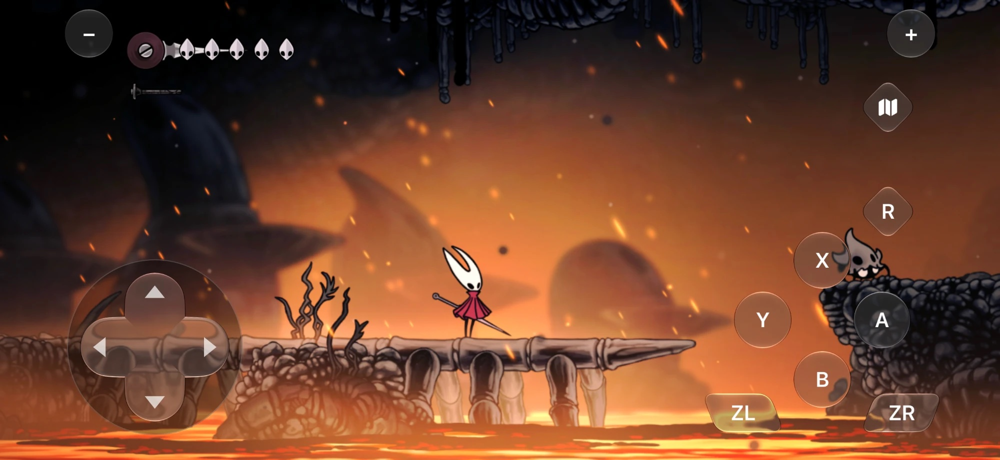
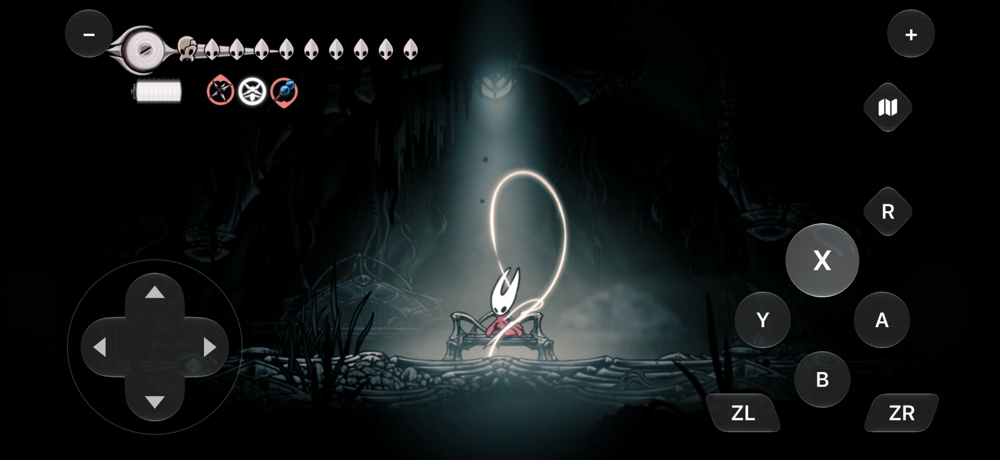

# Hollow Knight: Silksong

**English** | [简体中文](silksong.zh-CN.md)

**Required game files**: the v0 base NSP and the v655360 update NSP (game version 1.0.30000).

## Controls built for the game

- 🕹️ **Glass D-pad**: an 8-direction D-pad replaces the stick, sized to match the A, B, X, and Y group.
- 👆 **Slide between buttons**: slide from one face button to another, or onto ZR, without lifting your finger. For example, jump and attack in one motion.
- 🗺️ **Thumb-friendly layout**: ZL and ZR sit below the face buttons, R is above A, and the map button is below +. The controls stay near the screen edges and keep the health and silk display clear.
- 📐 **iPhone and iPad layouts**: each device type gets its own positions and button sizes.
- ⚡ **Fast response**: the glass press look ends as soon as you lift your finger.

## Touch everywhere else

- 📋 **Menus**: tap menu items and options, and drag sliders. The pad hides while a menu accepts touch.
- 🎒 **Inventory**: tap items, tap a page icon to jump to it, drag to scroll long lists, and tap crests in the Change Crest carousel.
- 💾 **Save select**: tap a slot to select it, and tap again to load.
- 🧭 **Map**: drag to move the map. Only Y, A, X, and B stay on screen, at the edges.
- 🎬 **Cutscenes**: the pad hides, and a Skip button shows when the game allows a skip.
- 🔄 **Smart hiding**: the pad hides on loading screens. It also hides when you use a physical controller, and comes back when you touch the screen.

## Picture and performance

- 🖥️ **Adaptive screen size**: the game fills the wide iPhone screen and the 3:2 iPad screen with no black bars.
- 🔍 **1080p rendering**: up to 1916×882 on iPhone and 1644×1080 on iPad, compared with the 720p handheld screen of the Switch.
- 🏎️ **120 Hz on ProMotion screens**: gameplay runs at 120 fps on iPhone, with a median frame time of 8.3 ms in testing.

## Screenshots

<table>
  <tr>
    <td align="center" width="50%"> A pressed button with the system glass effect</td>
    <td align="center" width="50%"> Inventory by touch</td>
  </tr>
  <tr>
    <td align="center" width="50%"> Map with Y, A, X, and B at the edges</td>
    <td align="center" width="50%"> Save select: tap to select, tap again to load</td>
  </tr>
</table>

## More

- See the improvements for every game in the [README](../../README.md).
